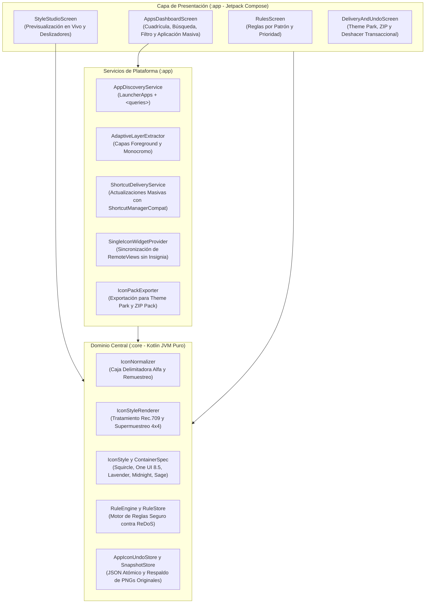

<p align="center">
  
</p>

# AndroidIconsAdmin

> **Utilidad local-first, determinista y automatizada para personalización y administración de iconos en Android 8.0 a 16 y Samsung One UI 8.5.**

[English](README.md) | [Español](README.es.md)

[](https://developer.android.com/)
[](https://www.samsung.com/)
[](https://kotlinlang.org/)
[](https://developer.android.com/jetpack/compose)
[](core/src/test)
[](LICENSE)

---

## Descripción del Proyecto

Inspirado en [WindowsIconsAdmin](https://github.com/AnaCataVC/windows-icons-admin), **AndroidIconsAdmin** traslada a Android la filosofía de personalización visual no destructiva, determinista y completamente automatizada. Permite crear un entorno estético y armónico en pantallas de inicio y launchers de terceros sin requerir root, alteraciones en el sistema, cuentas en la nube, telemetría ni modelos de IA en runtime.

Operando bajo los límites estrictos de seguridad de Android (sandboxing por UID de Linux, directivas SELinux y firmas de paquetes APK), AndroidIconsAdmin documenta e implementa los tres mecanismos legítimos y avalados por el sistema operativo para dispositivos sin root: **Widgets de Pantalla de Inicio sin Insignia**, **Accesos Directos Fijados con Actualización Silenciosa In-Place** y **Exportación de Icon Pack para Samsung One UI Theme Park y Launchers de Terceros**.

### Características Principales

- **Detección Automática de Apps (`<queries>`)**: Inspecciona todas las aplicaciones instaladas que tienen actividad de inicio mediante `LauncherApps` y `PackageManager` utilizando declaraciones estándar de manifiesto, sin requerir permisos restringidos por Google Play (`QUERY_ALL_PACKAGES`).
- **Extracción de Capas Sin Máscara (`AdaptiveIconDrawable`)**: Extrae directamente las capas `foreground` y `monochrome` (Android 13+) de los recursos del APK de cada app, evitando bordes dobles y el recorte prematuro del fabricante.
- **Pipeline Visual Determinista de 4 Fases (`:core` JVM)**:
  1. *Normalización Bilineal y Caja Delimitadora*: Detección por umbral de opacidad ($\alpha \ge 16$), márgenes configurables ($[0.0, 0.40]$) y detección de bordes opacos completos (*full-bleed*).
  2. *Tratamiento Tonal y de Color*: Saturación en espacio de luminancia Rec.709, ajuste lineal de brillo, curva de contraste y mezcla suave de tinte al 15%.
  3. *Contenedores con Supermuestreo Subpíxel*: Superelipses calculadas con muestreo $4\times 4$ antialiasing (`Squircle`, `One UI 8.5 Squircle`, `Cuadrado Redondeado`, `Círculo`, `Teardrop`).
  4. *Composición Alfa*: Mezcla Porter-Duff `SRC_OVER`.
- **Widgets de Pantalla de Inicio Sin Insignia (1×1 y Dock)**: Widgets nativos `AppWidgetProvider` que no muestran la insignia de la app creadora, compatibles con el redimensionamiento de One UI 8.5 *Home Up* y con actualización masiva en segundo plano.
- **Sincronización Masiva Silenciosa en Accesos Directos**: Mediante identificadores estables (`ShortcutManagerCompat.updateShortcuts`), actualiza todos los iconos fijados de la pantalla de inicio de forma simultánea e instantánea sin diálogos del sistema.
- **Integración con Samsung One UI 8.5 y Good Lock Theme Park**: Incluye los intent filters estándar de paquetes de iconos y cuenta con una función para exportar álbumes PNG de 512×512 a `Pictures/AndroidIconsAdmin/` vía `MediaStore` (sin necesidad de permisos de almacenamiento en Android 10+) para asignarlos directamente en el editor por app de Theme Park.
- **Exportador de Icon Packs para Launchers de Terceros**: Genera paquetes ZIP estructurados con `appfilter.xml`, `drawable.xml`, `theme_resources.xml` y los archivos PNG correspondientes.
- **Historial Transaccional de Deshacer (`AppIconUndoStore` y `OriginalSnapshotStore`)**: Persistencia atómica de archivos (`.tmp` a destino con recuperación `.bak`) que permite restaurar cualquier app, lote o todos los iconos a su estado original.

---

## Arquitectura Limpia

AndroidIconsAdmin mantiene un desacoplamiento estricto entre el motor de procesamiento de imágenes y los servicios del sistema Android.



### Responsabilidades por Módulo

| Módulo | Responsabilidad |
| :--- | :--- |
| **`:core`** | Librería independiente de Kotlin JVM puro (sin dependencias de `android.*`). Contiene `RgbaCanvas`, `IconNormalizer`, `IconStyleRenderer`, presets, `RuleEngine`, `StyleStore`, `AppSettingsService` y `AppIconUndoStore`. Validado con tests unitarios JUnit 5 que se ejecutan en milisegundos. |
| **`:app`** | Módulo de aplicación Android (`minSdk = 26`, `targetSdk = 35/36`). Implementa la interfaz en Jetpack Compose Material 3, `AdaptiveLayerExtractor`, `SingleIconWidgetProvider`, `ShortcutDeliveryService` y `IconPackExporter`. |

---

## Stack Tecnológico

- **Lenguaje y Entorno de Ejecución**: Kotlin 2.1.10, Java 21 LTS
- **Sistema de Compilación**: Android Gradle Plugin 8.8.2, Gradle 8.10.2, Catálogo de Versiones (`libs.versions.toml`)
- **Compatibilidad Android**: `minSdk = 26` (Android 8.0 Oreo), `targetSdk = 35` / `compileSdk = 35` (compatible con Android 15 y 16 One UI 8.5)
- **Interfaz de Usuario**: Jetpack Compose BOM 2025.02.00, Material 3 1.3.1, Diseño Edge-to-Edge (`enableEdgeToEdge()`)
- **Persistencia**: Serialización atómica JSON mediante `kotlinx.serialization-json` 1.8.0
- **Pruebas Automatizadas**: JUnit 5 (Jupiter 5.11.4) para el desarrollo Cleanroom TDD del dominio central

---

## Compilación y Ejecución

### Requisitos Previos

- [JDK 21](https://adoptium.net/) (o el JBR 21 de Android Studio)
- [Android SDK (API 35+)](https://developer.android.com/studio)

### Configuración Local y Compilación

Clona el repositorio y compila el proyecto:

```bash
# Clonar el repositorio
git clone https://github.com/AnaCataVC/android-icon-admin.git
cd android-icon-admin

# Ejecutar las pruebas unitarias del dominio central
./gradlew :core:test

# Compilar el APK de depuración
./gradlew :app:assembleDebug
```

El binario resultante se generará en:
`app/build/outputs/apk/debug/app-debug.apk`

---

## Pruebas Automatizadas

`AndroidIconsAdmin` cuenta con una suite integral de pruebas unitarias en `:core` que valida el cálculo matemático de píxeles, la detección de límites alfa, la protección contra regresiones ReDoS y la recuperación ante corrupción atómica:

```bash
./gradlew :core:test
```

---

## Decisiones de Arquitectura y Aprendizajes

1. **Límites de Seguridad en Android y Cero Soluciones Artificiales**: Las aplicaciones sin root no pueden alterar APKs ajenos ni escribir en los directorios privados de los launchers del sistema (`/data/data/com.sec.android.app.launcher`). En vez de atajos inestables, AndroidIconsAdmin ofrece vías de entrega transparentes y avaladas por el sistema: Widgets en Pantalla de Inicio (sin insignia), Accesos Directos (actualizables silenciosamente en bloque) y paquetes compatibles con Theme Park y launchers de terceros.
2. **Aislamiento en `:core` JVM Puro**: Separar el pipeline de renderizado de `android.graphics.Bitmap` y basarlo en `RgbaCanvas` permite que las pruebas unitarias se ejecuten en la JVM en milisegundos sin depender de Robolectric ni emuladores.
3. **Prevención del Doble Contenedor**: Al extraer la capa `foreground` limpia de `AdaptiveIconDrawable` y analizar los bordes alfa, se previene que un icono ya recortado por el fabricante quede encerrado dentro de otro contenedor.
4. **Integración con Samsung One UI 8.5 y Theme Park**: Theme Park de Samsung analiza los intent filters del manifiesto y permite asignaciones directas desde la galería. AndroidIconsAdmin exporta a `Pictures/AndroidIconsAdmin/` usando `MediaStore` (sin solicitar permisos de almacenamiento en Android 10+) para facilitar una personalización completa y uniforme en todo el sistema.

---

## Licencia

Este proyecto está bajo la Licencia MIT. Consulta el archivo [LICENSE](LICENSE) para más detalles.
