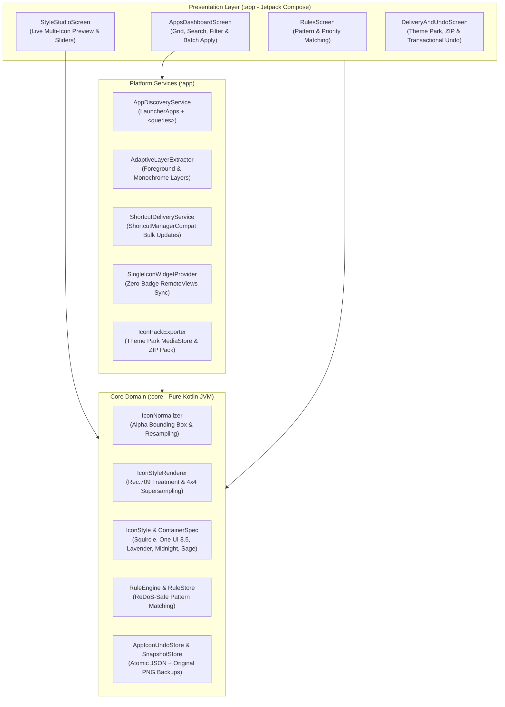

<p align="center">
  
</p>

# AndroidIconsAdmin

> **Automated, deterministic, local-first icon administration and styling utility for Android 8.0 to 16 and Samsung One UI 8.5.**

[English](README.md) | [Español](README.es.md)

[](https://developer.android.com/)
[](https://www.samsung.com/)
[](https://kotlinlang.org/)
[](https://developer.android.com/jetpack/compose)
[](core/src/test)
[](LICENSE)

---

## Project Description

Inspired by [WindowsIconsAdmin](https://github.com/AnaCataVC/windows-icons-admin), **AndroidIconsAdmin** brings automated, non-destructive, and deterministic icon styling to Android. It provides a cohesive, aesthetic app icon layout across home screens and third-party launchers without requiring root, system modification, cloud accounts, telemetry, or runtime AI models.

Operating under strict Android OS security boundaries (Linux UID sandboxing, SELinux, and APK signatures), AndroidIconsAdmin documents and implements the three legitimate, OS-sanctioned mechanisms for unrooted devices: **Zero-Badge Home Screen Widgets**, **Silent In-Place Pinned Shortcuts**, and **Standard Icon Pack / One UI Theme Park Exporting**.

### Key Features

- **Automated App Discovery (`<queries>`)**: Automatically inspects installed launchable applications via `LauncherApps` and `PackageManager` using standard manifest declarations without requesting Google Play-restricted broad permissions (`QUERY_ALL_PACKAGES`).
- **Layer-Aware Extraction (`AdaptiveIconDrawable`)**: Isolates raw unmasked foreground and monochrome layers (Android 13+) from target APK resources, avoiding double-container nesting and OEM clipping artifacts.
- **Deterministic 4-Stage Visual Pipeline (`:core` JVM)**:
  1. *Bilinear Normalization & Bounding Box*: Alpha thresholding ($\alpha \ge 16$) with configurable padding ratios ($[0.0, 0.40]$) and full-bleed edge detection.
  2. *Color & Tonal Treatment*: Rec.709 luminance saturation, linear brightness offset, contrast curve, and subtle 15% tint blending.
  3. *Subpixel Supersampled Containers*: $4\times 4$ supersampled superellipses (`Squircle`, `One UI 8.5 Squircle`, `RoundedSquare`, `Circle`, `Teardrop`).
  4. *Alpha Compositing*: Porter-Duff `SRC_OVER` blending.
- **Badge-Free Home Screen Widgets (1×1 & Dock)**: Native `AppWidgetProvider` widgets with zero creator-app badges, supporting Samsung One UI 8.5 *Home Up* scaling and silent bulk updates.
- **Silent In-Place Bulk Shortcut Sync**: Uses stable shortcut IDs (`ShortcutManagerCompat.updateShortcuts`) to update all pinned home screen icons simultaneously without confirmation sheets.
- **Samsung One UI 8.5 & Good Lock Theme Park Integration**: Bundles standard icon pack intent filters and exports 512×512 PNG albums directly to `Pictures/AndroidIconsAdmin/` via `MediaStore` for immediate assignment inside Theme Park's per-app icon editor.
- **Third-Party Launcher Pack Exporter**: Generates structured ZIP bundles containing `appfilter.xml`, `drawable.xml`, `theme_resources.xml`, and normalized PNGs.
- **Transactional Undo (`AppIconUndoStore` & `OriginalSnapshotStore`)**: Atomic file persistence (`.tmp` -> target with `.bak` recovery) capable of restoring any single app, batch, or all icons back to original snapshots.

---

## Clean Architecture

AndroidIconsAdmin enforces strict decoupling between domain image processing and Android platform APIs.



### Module Responsibilities

| Module | Responsibility |
| :--- | :--- |
| **`:core`** | Target-independent pure Kotlin JVM library (zero `android.*` dependencies). Houses `RgbaCanvas`, `IconNormalizer`, `IconStyleRenderer`, presets, `RuleEngine`, `StyleStore`, `AppSettingsService`, and `AppIconUndoStore`. Verified via millisecond JUnit 5 tests. |
| **`:app`** | Android application module (`minSdk = 26`, `targetSdk = 35/36`). Implements Jetpack Compose Material 3 UI, `AdaptiveLayerExtractor`, `SingleIconWidgetProvider`, `ShortcutDeliveryService`, and `IconPackExporter`. |

---

## Tech Stack

- **Language & Runtime**: Kotlin 2.1.10, Java 21 LTS
- **Build System**: Android Gradle Plugin 8.8.2, Gradle 8.10.2, Version Catalog (`libs.versions.toml`)
- **Android Targets**: `minSdk = 26` (Android 8.0 Oreo), `targetSdk = 35` / `compileSdk = 35` (Android 15 / 16 One UI 8.5 compatible)
- **UI Toolkit**: Jetpack Compose BOM 2025.02.00, Material 3 1.3.1, Edge-to-Edge (`enableEdgeToEdge()`)
- **Persistence**: Atomic JSON serialization via `kotlinx.serialization-json` 1.8.0
- **Testing**: JUnit 5 (Jupiter 5.11.4) for core domain Cleanroom TDD

---

## Getting Started

### Prerequisites

- [JDK 21](https://adoptium.net/) (or Android Studio JBR 21)
- [Android SDK (API 35+)](https://developer.android.com/studio)

### Local Setup & Compilation

Clone the repository and build the project:

```bash
# Clone repository
git clone https://github.com/AnaCataVC/android-icon-admin.git
cd android-icon-admin

# Execute core domain Cleanroom unit tests
./gradlew :core:test

# Compile debug APK
./gradlew :app:assembleDebug
```

The resulting debug APK will be generated at:
`app/build/outputs/apk/debug/app-debug.apk`

---

## Automated Testing

`AndroidIconsAdmin` features comprehensive Cleanroom unit tests in `:core` verifying deterministic pixel math, alpha boundary detection, ReDoS timeout guards, and atomic persistence recovery:

```bash
./gradlew :core:test
```

---

## Key Learnings & Architectural Decisions

1. **Android Security Boundaries & Zero Fake Workarounds**: Non-root Android apps cannot modify third-party APKs or write into private launcher caches (`/data/data/com.sec.android.app.launcher`). Instead of fragile hacks, AndroidIconsAdmin provides real, transparent delivery routes: Home Screen Widgets (badge-free), Pinned Shortcuts (silent in-place bulk updates), and Theme Park/ZIP icon packs.
2. **Pure Kotlin `:core` JVM Isolation**: Decoupling the rendering pipeline from `android.graphics.Bitmap` into `RgbaCanvas` allows instantaneous unit test execution in pure JVM without Robolectric or an emulator.
3. **Double-Container Avoidance**: Extracting raw `drawable.foreground` from `AdaptiveIconDrawable` and evaluating edge alpha eliminates ugly double-nested borders.
4. **Samsung One UI 8.5 & Theme Park Alignment**: Samsung's Theme Park scans installed packages for icon pack intent filters and allows direct gallery assignments. AndroidIconsAdmin exports directly to `Pictures/AndroidIconsAdmin/` via `MediaStore` (zero permissions needed on Android 10+) to make full-system One UI styling friction-free.

---

## License

This project is licensed under the MIT License. See [LICENSE](LICENSE) for details.
